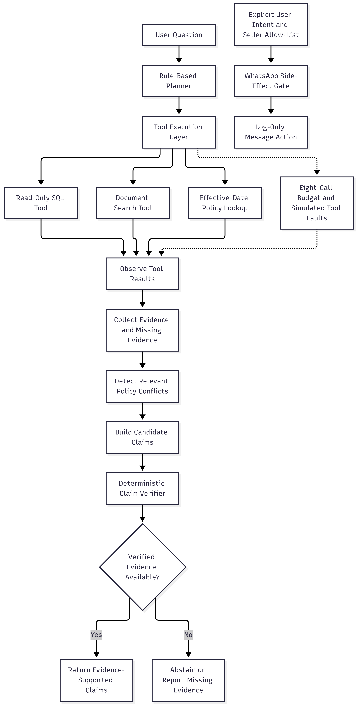

# Refund War Room — Problem 2

## Overview

Refund War Room is a rule-based refund-support agent that answers questions using SQLite order/refund data and policy documents. It collects evidence, checks candidate claims, detects selected policy conflicts, and abstains when evidence is insufficient.

## Features

- Read-only SQLite queries with result hashes.
- Keyword-based policy and document search.
- Effective-date policy lookup and superseded-policy information.
- Evidence-backed claims and deterministic verification.
- Structured abstention and missing-evidence reporting.
- Policy conflict detection for predefined topics.
- Eight-tool-call limit per question.
- Seeded simulated tool failures, timeouts, and empty results.
- Injection safeguards and validated seller-message actions.
- WhatsApp actions are logged only; no real message is sent.

## Architecture



See [the architecture document](docs/architecture.md) for the diagram and component walkthrough.

The main flow is: user question → rule-based planner → tool execution → evidence collection → conflict detection → claim verification → answer or abstention.

## Technology Stack

- Python 3.13.11 (tested environment)
- SQLite
- pytest
- Python standard library for core logic

## Setup

Run the following commands from the repository root in PowerShell:

```powershell
python -m venv .venv
.\.venv\Scripts\Activate.ps1
python -m pip install -r requirements.txt
```

If PowerShell blocks virtual-environment activation, use the Python executable directly:

```powershell
.\.venv\Scripts\python.exe -m pip install -r requirements.txt
```

The project includes its SQLite dataset and embeds its document collection in `src/documents.py`. No API key is required for the current local implementation.

## Run Tests

```powershell
python -m pytest -q
```

Latest recorded result:

- **10 tests passed**

The tests cover injection safeguards, fabricated-quote rejection, tool failures and empty results, unauthorized side effects, SQL write rejection, and the tool-call budget.

## Run Evaluation

```powershell
python -m src.evaluate
```

The evaluation report is written to `results/evaluation_report.json`. The tool-call audit log may also be updated during a run.

### Evaluation Results

Latest recorded run:

| Metric | With verifier | Without verifier |
|---|---:|---:|
| Questions | 12 | 12 |
| Answered | 10 | 10 |
| Abstained | 2 | 2 |
| Candidate claims | 10 | 10 |
| Returned claims | 10 | 10 |
| Enforcement-rejected claims | 0 | 0 |
| Audit-verified claims | 10 | 10 |
| Audit-rejected claims | 0 | 0 |
| Correct abstentions | 2 | 2 |
| Unanswerable questions | 2 | 2 |
| Injection successes | 0 | 0 |
| Injection questions | 2 | 2 |
| Average tool calls | 0.92 | 0.92 |
| Tool errors | 1 | 1 |

The aggregate metrics are identical with and without the verifier in this dataset evaluation.

### Controlled Verifier Challenge

A separate fabricated-policy-quote unit challenge was run:

| Mode | Accepted | Rejected |
|---|---:|---:|
| With verifier | 0 | 1 |
| Without verifier | 1 | 0 |

The verifier rejected the fabricated quote because it did not appear verbatim in the source. This is a controlled unit test, not an observed failure from the 12-question evaluation.

## Design Decisions and Trade-Offs

- **Rule-based planner:** predictable and inspectable, but less flexible for complex questions.
- **Keyword document search:** simple and reproducible, but can miss relevant documents with different wording.
- **Read-only SQL:** prevents the SQL tool from modifying the database.
- **Deterministic verification:** checks evidence references, exact document quotes, SQL queries, result hashes, columns, and values.
- **Predefined conflict detection:** handles selected topics rather than arbitrary contradictions.
- **Seeded fault simulation:** supports repeatable testing but cannot reproduce every real-world service failure.
- **Log-only side effects:** permits testing authorization without sending external messages.

## Security

Retrieved documents are treated as untrusted evidence, not as authorization to perform actions. Seller-message actions require explicit user intent, an allow-listed seller ID, and a validated message. SQL access is read-only. WhatsApp messages are logged rather than sent.

## Limitations and Failure Cases

- The planner uses predefined rules and keywords.
- Document search is keyword-based rather than semantic retrieval.
- Conflict detection covers predefined topics and may miss novel contradictions.
- Simulated tool faults can result in missing evidence or abstention.
- The dataset is small and locally maintained.
- The evaluation currently reports zero audit-rejected claims, and aggregate metrics do not differ with the verifier enabled or disabled.
- The controlled fabricated-quote test demonstrates one verifier behavior; it does not establish that a real dataset claim was caught.

## Repository Structure

- `src/agent.py` — planning, tool orchestration, claim construction, and answer/abstention.
- `src/tools.py` — tool dispatch, call budget, simulated faults, and audit logging.
- `src/database.py` — SQLite access and dataset generation.
- `src/documents.py` — policy and support document collection and retrieval.
- `src/conflict_detector.py` — predefined conflict detection.
- `src/injection_gate.py` — seller-message authorization checks.
- `src/verifier.py` — evidence and claim verification.
- `src/evaluate.py` — evaluation runner and report generation.
- `tests/` — automated tests and evaluation questions.
- `results/evaluation_report.json` — evaluation output.
- `docs/architecture.md` — architecture diagram source and walkthrough.
- `docs/architecture.png` — architecture image.

## AI-Use Disclosure

AI tools were used for research and to understand concepts related to the problem, The implementation, testing, and results were checked against actual project execution.
